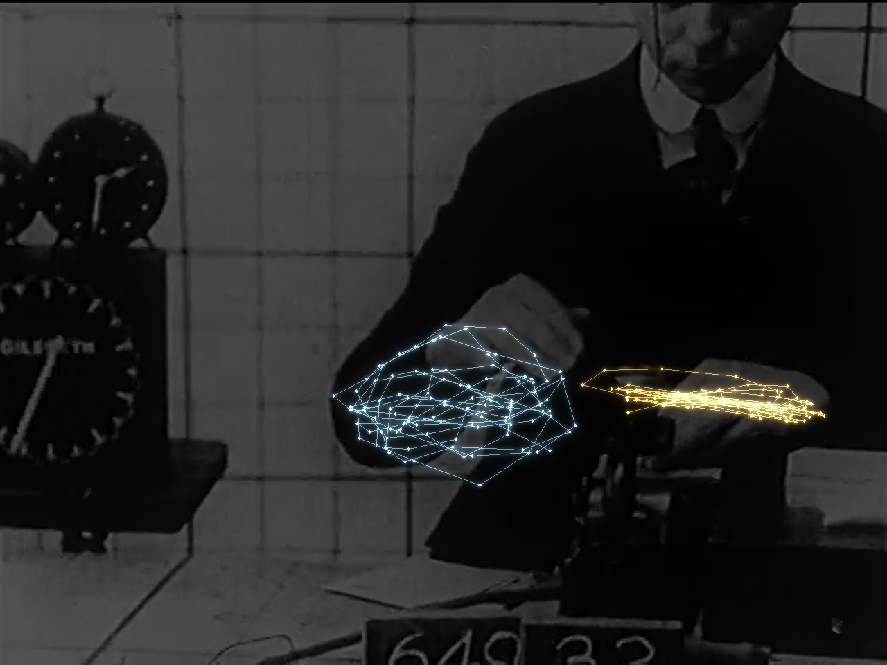

# Computing Therbligs

**Can algorithms identify the Gilbreths' elementary motions of work better than their analysts did?**

Frank and Lillian Gilbreth broke hand work into 17 elementary motions, or *therbligs* (reach, grasp, move,
hold, release; so on). Their analysts named and timed each one by studying film recorded by the pair of workers frame by frame. This project re-attempts that analysis with computer vision, annotating every frame of one of their films with the [Distant Viewing Toolkit](https://github.com/distant-viewing/dvt), with results across the whole film checked. Outcome is scored against five criteria.

Full write-up: [`docs/Computing_Therbligs.pdf`](docs/Computing_Therbligs.pdf) (also as [Word](docs/Computing_Therbligs.docx))



## Verdict: not better than the Gilbreths

| Analysis | Outcome | Evidence |
|---|---|---|
| Timing movements accurately | Positive | Within 3% of the title card figures, once corrected by the clock in the frame |
| Following the hands in every frame | Partly positive | Reliable in close shots; weak in wide shots; fails on hands shown alone |
| Finding distinct elementary motions | Negative | 7 weakly separated types (silhouette 0.23), not 17 |
| Ensuring units belong only to human movement, rather than the sampling | Negative | Halving the frames examined halves the motions found |
| Covering all 17 therbligs | Negative | Finger, stillness and eye motions leave no trace the model can register |

The machine matches the Gilbreths where they relied on a clock, which is rather positive. But it falls markedly short in designating human action.

## Data

*Original Films of Frank B. Gilbreth*, Part I (Prelinger Archives, public domain): research footage from
1910–1924, 15 min 24 s. Download instructions: [`data/README.md`](data/README.md).

## How it works

| Script | What it does | Main output |
|---|---|---|
| `01_shots.py` | Splits the film into shots (toolkit shot detector, TransNetV2) and reads the title cards (Tesseract) | `out/shots.csv` |
| `02_keypoints.py` | Finds each person and 17 body joints in sampled frames (toolkit Keypoint R-CNN weights) | `out/kp_dense*.csv` |
| `03_analyse.py` | Follows the wrists from frame to frame, cuts their paths into motions where the hand slows, groups the motions | `out/units_dense.csv`, `out/alphabet_dense.json` |
| `04_figures.py` | Draws the light-trail images, contact sheet and motion types | `out/figures/` |
| `05_clock.py` | Reads the hand of the on-screen clock (microchronometer) in every frame | `out/clock_summary.csv` |
| `06_rhythm.py`, `10_rqa.py` | Measures how regularly a worker's posture repeats | `out/rhythm_summary.csv`, `out/rqa.csv` |
| `07_bergson.py` | Repeats the motion analysis with every 2nd and every 4th frame (sampling test) | `out/bergson_summary.csv` |
| `08_requisitions.py` | Compares clock-corrected work rates with the title card figures | `out/requisitions.csv` |
| `09_holds.py` | Measures how long hands are held still | `out/holds.csv` |

## Key settings

These determine the results, quite entirely.

| Setting | Where | Value | What it means |
|---|---|---|---|
| Sampling | `02_keypoints.py --stride` | 2 | Every 2nd video frame: about 15 frames per second of film |
| Model input size | `common.load_keypoint_model` | 600 | Frames are scaled so the short side is 600 pixels before the pose model sees them |
| `MIN_PERSON` | `03_analyse.py` | 0.6 | How confident the model must be that it sees a person before that person is tracked |
| `KP_THR` | `03_analyse.py` | 0.5 | How confident it must be about a wrist before the wrist position is used |
| `MAX_GAP` | `03_analyse.py` | 3 | Missing wrist positions bridged by drawing a straight line, up to 3 frames |
| Cutting rule | `03_analyse.py` | speed minima | A motion ends where hand speed dips noticeably (prominence ≥ 0.15 shoulder-widths per second) |
| `K_RANGE` | `03_analyse.py` | 4–12 | Numbers of motion types tried; the one with the best silhouette score is kept |
| `EPS` | `10_rqa.py` | 0.3 | Two postures "match" if they differ by less than 0.3 shoulder-widths |

All distances are measured in shoulder-widths, so that a worker near the camera or far away are comparable.

## Running the model

```
python -m venv .venv && source .venv/bin/activate
pip install -r requirements.txt
# put OriginalFilm.mp4 in data/, then from scripts/:
python 01_shots.py
python 02_keypoints.py denseA --stride 2 --shots 17,19,21,23,32,33,34,36
python 02_keypoints.py denseB --stride 2 --shots 38,40,42,43,44,46,47
python 02_keypoints.py denseC --stride 2 --shots 26,28,30
python 03_analyse.py dense
python 05_clock.py && python 06_rhythm.py dense && python 07_bergson.py
python 08_requisitions.py && python 09_holds.py && python 10_rqa.py
```

## Limits

- One 15-minute film; only three shots in which the clock is readable.
- The timing check rests on 10–11 work cycles per method, counted by eye (frames listed in `08_requisitions.py`).
- The pose model was trained on modern photographs, so has no direct reference for 1910s film.
- In the sampling test, smoothing is set in frames (7), so coarser sampling also smooths over a longer stretch of time. With smoothing fixed at 0.467 s instead (`SMOOTH_S=0.467 python 03_analyse.py dense --every N`), motions per second fall from 2.39 to 1.45 and 0.79 rather than to 1.27 and 0.64: a smaller drop, but motions still last 4–5 frames at every rate.
